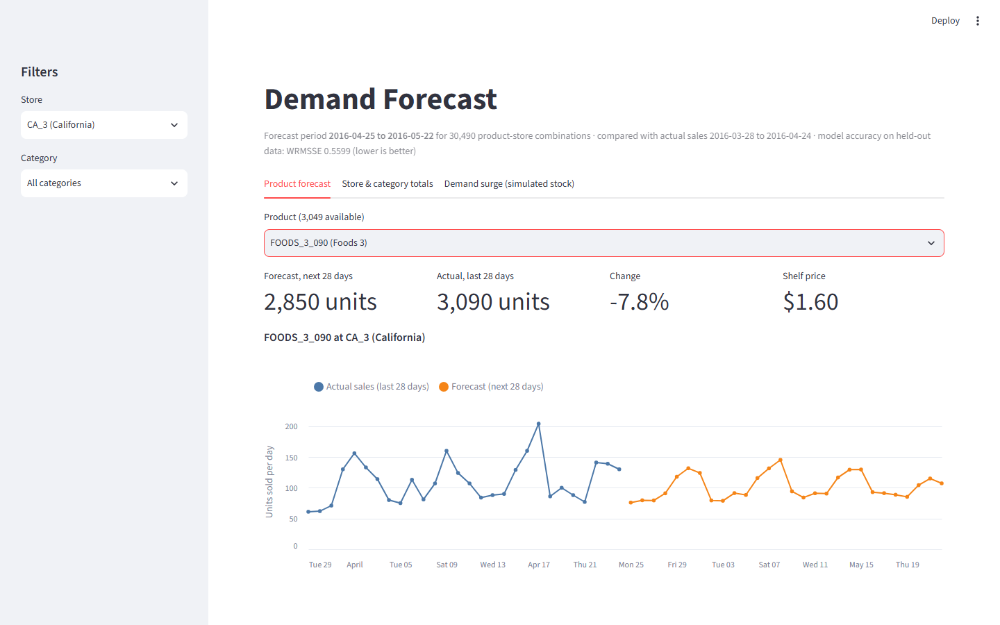
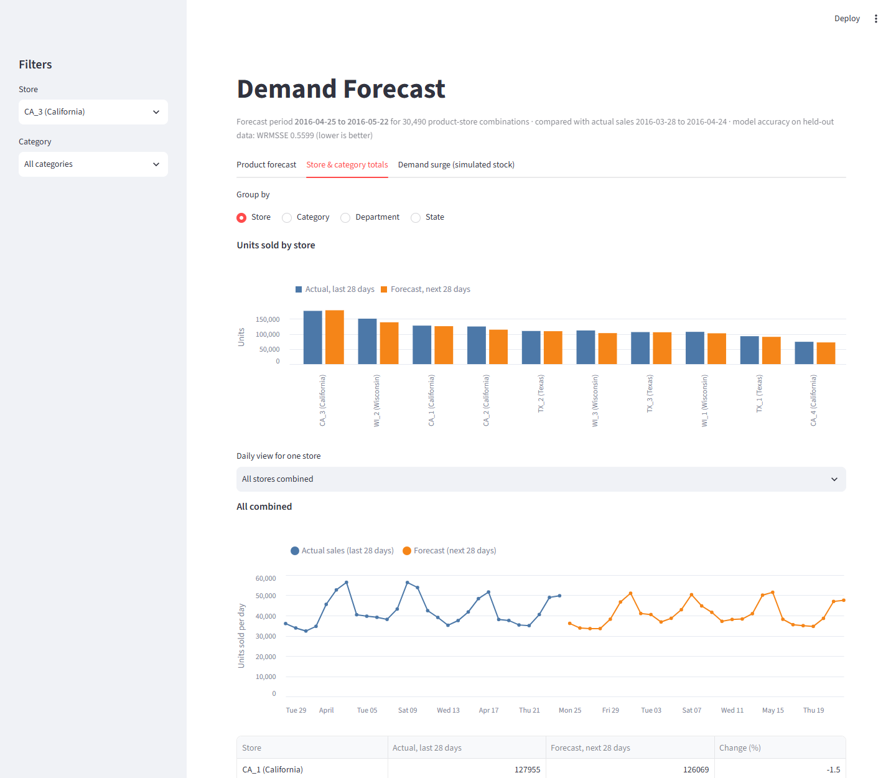
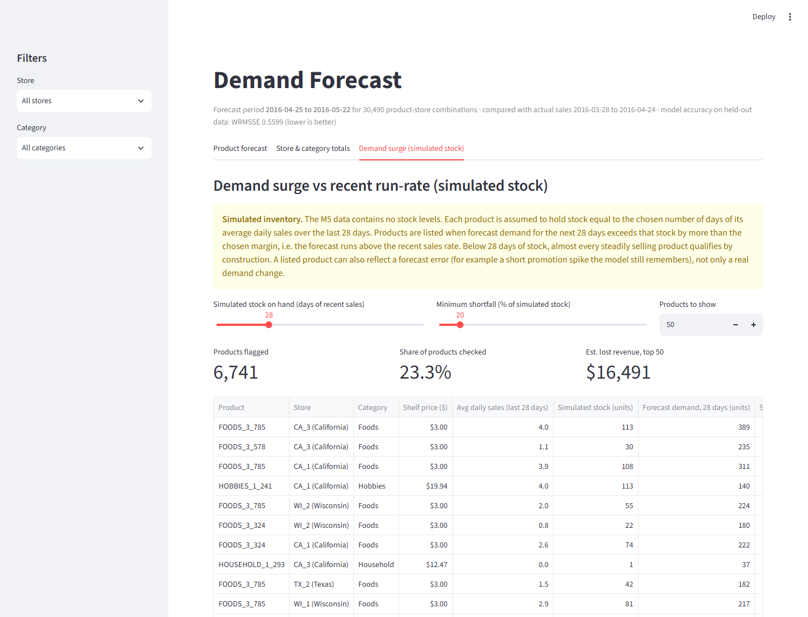

# Demand Forecasting & Inventory Optimization Engine

End-to-end hierarchical retail demand forecasting on the Kaggle **M5** dataset (Walmart unit sales).
The goal is a complete system: baselines → LightGBM → PySpark pipeline → FastAPI + Streamlit → drift monitoring.
Models are evaluated with **WRMSSE**, the official M5 accuracy metric.

**Current result:** a tuned global LightGBM model reaches **WRMSSE 0.5599** on a 28-day hold-out,
vs **0.9228** for Seasonal Naive and **1.4864** for Naive (first LightGBM version: 0.6341).

## Dataset

[M5 Forecasting – Accuracy](https://www.kaggle.com/competitions/m5-forecasting-accuracy) (Kaggle).
Daily unit sales for 3,049 products in 10 stores across 3 US states (CA, TX, WI), giving 30,490
item-store series from 2011-01-29 to 2016-04-24. Files used:

| File | Content |
|---|---|
| `sales_train_validation.csv` | Daily unit sales per item-store |
| `calendar.csv` | Dates, weekdays, events, SNAP days |
| `sell_prices.csv` | Weekly price per item-store |

Findings from EDA:
- After trimming each series to start at its release week, **59.7%** of rows are zero sales
  (HOBBIES is the most intermittent category).
- Stores are closed every December 25.

## Pipeline

1. **Cleaning** (notebooks 01–02): melt sales to long format, merge the calendar, cast to compact
   category/int32 dtypes, add `is_store_closed` (Dec 25), and drop rows before each item's release
   week (its first week with a price). Output: `data/processed/sales_long_clean.parquet`,
   46,027,957 rows × 20 columns.
2. **Split** (time-based, never random): validation = last 28 days (2016-03-28 → 2016-04-24),
   train = everything before.
3. **Metric** (`src/metrics.py`): WRMSSE over all 12 M5 aggregation levels (42,840 series).
   - Scale: mean squared one-step difference over train, from each series' first non-zero sale.
   - Weights: dollar sales (units × price) over the last 28 days of train.
   - Final score: the mean of the 12 level scores.
4. **Baselines** (`src/models/baselines.py`): Naive (repeat the last day) and Seasonal Naive (repeat the last week).
5. **Features** (`src/features.py`), built per store to limit memory:
   - Lags at 28, 35 and 42 days.
   - Rolling mean/std over 7, 14 and 28 days on sales shifted 28 days.
   - Calendar: day of week, day of month, week of year, month, events, SNAP, store closed.
   - Price: sell price, week-over-week change, price relative to the store-category mean,
     4-week rolling mean price, and price relative to that mean.
   - Intermittency: length of the zero-sales run ending at t−28.

   Every sales-derived feature looks at least 28 days back, so the whole 28-day horizon is
   forecast without leakage or recursive prediction.
6. **Global LightGBM** (`src/models/lgbm.py`): a single model for all series.
   - Training data is streamed store by store (`lgb.Sequence`), so 23M rows fit in 16 GB of RAM.
   - Three time windows:
     - **fit:** 2014-01-01 → 2016-02-28
     - **inner:** 2016-02-29 → 2016-03-27, for early stopping and for comparing configs by WRMSSE,
       using an evaluator built only from data up to 2016-02-28
     - **validation:** 2016-03-28 → 2016-04-24, scored once, for the final config only
   - Final config: Tweedie (variance power 1.1), learning rate 0.02, 127 leaves, `lambda_l2` 1.0,
     `min_data_in_leaf` 500, best iteration 351.

### Model selection

Experiments ran one at a time; each kept the best config so far. Selection used **inner-window
WRMSSE only** (reference on that window: Seasonal Naive 0.8889, Naive 1.6956).

| Exp | Change | Train rows | Best iter | Inner WRMSSE |
|---|---|---:|---:|---:|
| E0 | First model: lr 0.05, train from 2015 | 12.8M | 78 | 0.7177 |
| E1 | lr 0.02, `lambda_l2` 1.0, `min_data_in_leaf` 500, patience 200 | 12.8M | 304 | 0.6904 |
| E2 | Train from 2014-01-01 | 23.1M | 304 | 0.6807 |
| **E3** | **+ day of month, week of year, price trend, zero streak** | 23.1M | 351 | **0.6535** |
| E4 | Tweedie power 1.3 instead of 1.1 (not kept) | 23.1M | 345 | 0.6553 |

## Results

WRMSSE on the validation window 2016-03-28 → 2016-04-24 (lower is better). "LightGBM v1" is the
first model (E0 config); "LightGBM" is the final model (E3 config).

| Level | Naive | Seasonal Naive | LightGBM v1 | LightGBM |
|---|---:|---:|---:|---:|
| total | 1.3843 | 0.6677 | 0.4133 | **0.3029** |
| state | 1.6089 | 0.7245 | 0.4730 | **0.3875** |
| store | 1.6322 | 0.8252 | 0.5184 | **0.4698** |
| cat | 1.4183 | 0.7543 | 0.4813 | **0.3516** |
| dept | 1.5939 | 0.9738 | 0.5904 | **0.4572** |
| state_cat | 1.5719 | 0.8347 | 0.5516 | **0.4560** |
| state_dept | 1.6359 | 0.9844 | 0.6530 | **0.5447** |
| store_cat | 1.6297 | 0.9205 | 0.6140 | **0.5554** |
| store_dept | 1.6808 | 1.0290 | 0.6994 | **0.6277** |
| item | 1.2699 | 1.1143 | 0.8891 | **0.8603** |
| item_state | 1.2361 | 1.1192 | 0.8732 | **0.8592** |
| item_store | 1.1752 | 1.1259 | 0.8527 | **0.8461** |
| **WRMSSE** | **1.4864** | **0.9228** | **0.6341** | **0.5599** |

Notes:
- Tuning mostly helped the aggregated levels: total 0.41 → 0.30, cat 0.48 → 0.35. The item levels
  improved only slightly (0.85–0.89 → 0.85–0.86).
- Feature gain is dominated by the 28-day rolling mean (~75%), followed by `item_id`, the 14-day
  rolling mean and the 28-day rolling std. Each new feature contributes ≤0.5% of gain, but
  together they gave the largest inner-window improvement (0.6807 → 0.6535).
- For reference, the global (non-WRMSSE) RMSE / MAE of the baselines is 3.301 / 1.350 for Naive
  and 2.759 / 1.232 for Seasonal Naive.

## Error analysis

`src/analysis.py` and `notebooks/04_error_analysis.ipynb` analyze the final model's validation
forecast. The analysis ran after the config was locked, so nothing in it fed back into tuning.

- **Error is spread out.** The 20 worst series account for 4.2% of the bottom-level error (2.7% of
  dollar weight). Every category and department contributes roughly its share of sales
  (over-index 0.90–1.06).
- **WI_2 is the hardest store** (over-index 1.16). It is also the hardest store for Seasonal Naive,
  so the store is noisier rather than this being a model-specific failure.
- **The largest errors are unexplained level changes in high-volume items, not intermittency.**
  - Short spikes in the last 28 training days are still in the ≥28-day-lagged features, which
    causes over-forecasts.
  - Surges that start inside the validation window, with no price change or event, cause
    under-forecasts.
- **The model under-forecasts slightly (−2.4% in total), most on weekends.** Sunday has the largest
  error. Error does not grow with the forecast horizon, because every day uses the same ≥28-day-old
  information.
- **Intermittent series are only slightly harder.** Series with 80–100% zero days over-index by 4%
  but carry 6.5% of the weight. LightGBM beats Seasonal Naive by 0.26–0.36 in every zero-share bucket.
- **SHAP:** `rmean_28` dominates. `dow` and `dept_id` matter much more for individual predictions
  than their split gain suggests.

## Serving: API and dashboard

The final model's forecast for the 28 days after the data ends (**2016-04-25 → 2016-05-22**)
is served by a FastAPI service and shown in a Streamlit dashboard.

- **Forecast generation** (`src/forecast.py`):
  - Future feature rows come from the same code path as training. `calendar.csv` and the price file
    extend past the end of sales, and every sales feature is ≥28 days old.
  - Output: `data/serving/forecasts.parquet` (4.4 MB), `actuals_last28.parquet` (0.7 MB) and
    `metadata.json`.
  - Sanity check: the 28-day forecast totals 1,142,145 units, against 1,183,626 sold in the last
    28 actual days.
- **API** (`api/`):

  | Endpoint | Purpose |
  |---|---|
  | `GET /health` | Model, forecast window, number of series |
  | `GET /catalog?store_id&cat_id` | Stores, categories, departments, items |
  | `GET /forecast?item_id&store_id&start&end` | Daily forecast for one item in one store, plus its last 28 days of sales |
  | `GET /aggregate?level=store\|cat\|dept\|state&key=` | Totals per group, and daily forecast vs actuals for one group |
  | `GET /alerts?days_of_cover=N&min_shortfall_pct=20&store_id&cat_id&limit` | Demand surge vs recent run-rate (**simulated stock**), ranked by estimated lost revenue |

  - Unknown ids return 404. Malformed or out-of-window dates, and invalid parameters, return 422.
  - Interactive docs are at `/docs`.
- **Dashboard** (`dashboard/app.py`): has three tabs, and reads only from the API.
  - **Product forecast:** recent sales vs forecast for one product in one store.
  - **Store & category totals:** actuals vs forecast by store, category, department or state.
  - **Demand surge (simulated stock):** products whose forecast runs above their recent sales
    rate, with sliders for days of stock and minimum shortfall.

**Dashboard screenshots** (served from the Docker containers):







> **Demand surge vs recent run-rate (simulated stock).** M5 contains no inventory data. Each series
> is assumed to hold stock equal to *N days* of its average daily sales over the last 28 days. A
> series is flagged when its 28-day forecast demand exceeds that stock by more than
> `min_shortfall_pct` (default 20%).
>
> Series flagged, of 28,903 with recent sales:
>
> | Days of cover | 0% margin | 20% margin (default) | 50% margin |
> |---|---:|---:|---:|
> | 21 | 25,744 | 18,395 | 8,349 |
> | 28 | 12,955 | 6,741 | 3,487 |
> | 35 | 5,861 | 3,487 | 2,061 |
> | 60 | 1,551 | 1,095 | 676 |
>
> - From N = 28 upward, the list isolates items whose forecast runs above their recent run-rate.
>   Below 28, most steadily selling items qualify by construction.
> - Flags can also reflect **model errors**, not only real demand changes. For example, an item
>   whose short promotion spike is still in the ≥28-day-lagged features (see Error analysis)
>   appears in the list.

## Repository structure

```
├── data/
│   ├── raw/                  # M5 CSVs (not tracked)
│   ├── processed/            # cleaned parquet + per-store features (not tracked)
│   └── serving/              # forecasts + recent actuals for the API (generated, not tracked)
├── docs/img/                 # dashboard screenshots
├── notebooks/
│   ├── 01_first_look.ipynb           # initial exploration
│   ├── 02_eda_demand_patterns.ipynb  # EDA + cleaning, writes sales_long_clean.parquet
│   ├── 03_baselines.ipynb            # time split, baselines, WRMSSE evaluation
│   └── 04_error_analysis.ipynb       # error analysis of the final LightGBM model
├── src/
│   ├── data.py               # loaders, time split, long -> wide pivot
│   ├── metrics.py            # WRMSSEEvaluator (12-level M5 hierarchy)
│   ├── features.py           # lag / rolling / calendar / price / intermittency features
│   ├── analysis.py           # error analysis: error shares, top series, horizon, SHAP
│   ├── forecast.py           # final model -> data/serving/ (next 28 days, all series)
│   └── models/
│       ├── baselines.py      # Naive, Seasonal Naive
│       └── lgbm.py           # global LightGBM: streaming train, inner/val evaluation, experiment log
├── api/                      # FastAPI service: main.py (routes), schemas.py, data.py
├── dashboard/app.py          # Streamlit dashboard (reads from the API)
├── tests/                    # WRMSSE checks; API tests on synthetic serving data
├── Dockerfile, docker-compose.yml   # serving image: API + dashboard
├── requirements.txt          # full environment (training + serving)
└── requirements-serving.txt  # pinned, for the Docker image
```

## How to reproduce

1. **Environment**

   ```bash
   python -m venv .venv
   ```
   ```bash
   .venv/Scripts/python -m pip install -r requirements.txt
   ```
   (`.venv/Scripts/` on Windows, `.venv/bin/` on Linux/macOS.)

2. **Data**: download the M5 files from the
   [Kaggle competition page](https://www.kaggle.com/competitions/m5-forecasting-accuracy/data)
   and put `sales_train_validation.csv`, `calendar.csv` and `sell_prices.csv` in `data/raw/`.

3. **Clean**: run `notebooks/02_eda_demand_patterns.ipynb` from the `notebooks/` folder. It
   writes `data/processed/sales_long_clean.parquet`.

4. **Features** (all 10 stores, about 2 minutes):

   ```bash
   python -m src.features
   ```

5. **Train and evaluate the final LightGBM config** (about 8 minutes). This prints the best iteration,
   feature importances, and per-level WRMSSE on the inner and validation windows. The model,
   validation predictions and an experiment record are saved to `artifacts/`. Leave out
   `--score-val` when trying new configs, so the validation window stays untouched.

   ```bash
   python -m src.models.lgbm --name final --features extended --train-start 2014-01-01 --lr 0.02 --lambda-l2 1.0 --min-data-in-leaf 500 --patience 200 --score-val
   ```

6. **Error analysis**: run `notebooks/04_error_analysis.ipynb`. It reads the final model and its
   validation predictions from `artifacts/`.

7. **Generate the serving forecast** (about 2 minutes). This writes `data/serving/`.

   ```bash
   python -m src.forecast
   ```

8. **Run the API and dashboard locally**, in two terminals. The dashboard is then at
   http://localhost:8501 and the API docs at http://localhost:8000/docs.

   ```bash
   uvicorn api.main:app --port 8000
   ```
   ```bash
   streamlit run dashboard/app.py
   ```

9. **Or run both with Docker** after step 7. The image contains only the serving code;
   `data/serving/` is mounted read-only.

   ```bash
   docker compose up --build
   ```

10. **Tests**

   ```bash
   python -m pytest tests
   ```

Memory: the full dataset is 46M rows, so the code keeps compact dtypes, builds features per
store, and loads only the columns it needs. Training data is streamed one store at a time, so training from 2014 (23M rows) fits in 16 GB.

## Roadmap

- [x] Data cleaning and EDA
- [x] WRMSSE metric and Naive / Seasonal Naive baselines
- [x] Feature engineering and global LightGBM (WRMSSE 0.6341)
- [x] LightGBM tuning: regularization and lower learning rate, train from 2014, extra features
  (WRMSSE 0.6341 → 0.5599)
- [x] Error analysis of the final model
- [ ] LightGBM follow-ups suggested by the error analysis:
  - Horizon-specific models with shorter lags for days 1–7.
  - A weekend correction.
  - Per-store models.
  - Refit through 2016-03-27 at the chosen iteration count.
- [ ] Classical models: ARIMA / Prophet at category level, Croston for intermittent items
- [ ] Move the cleaning steps from the notebooks into a `src/` script
- [ ] PySpark feature pipeline
- [x] FastAPI forecasting service, Streamlit dashboard and Docker setup (alerts on simulated inventory)
- [ ] Drift monitoring
